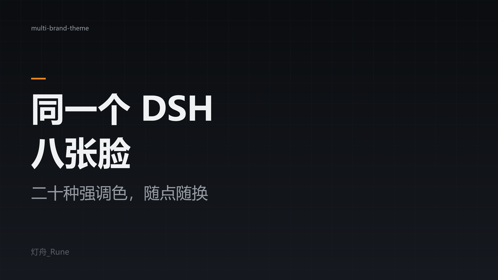
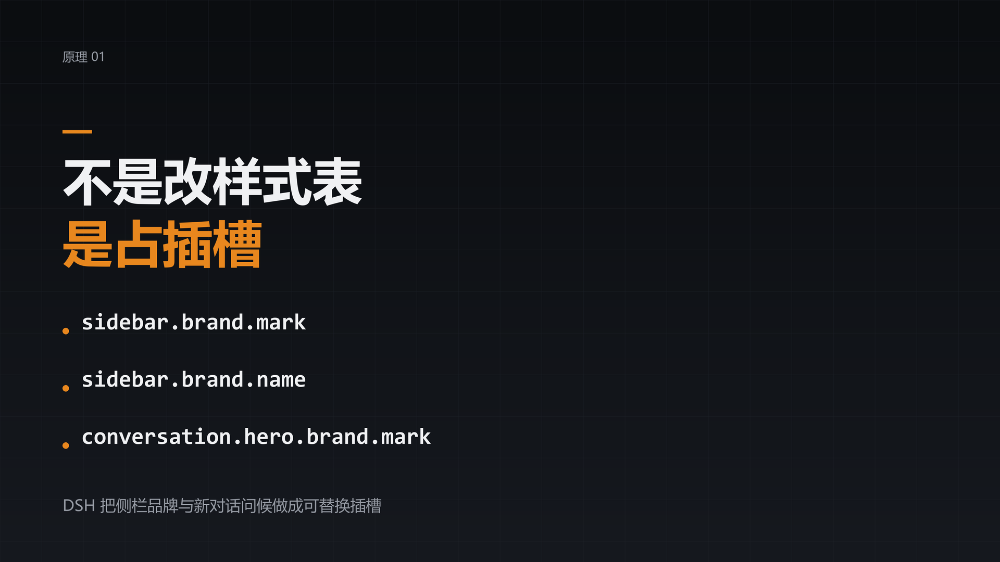
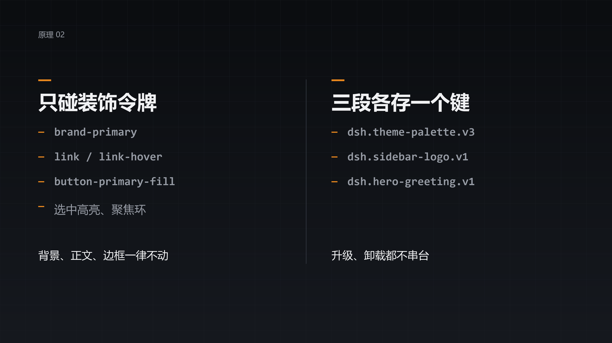
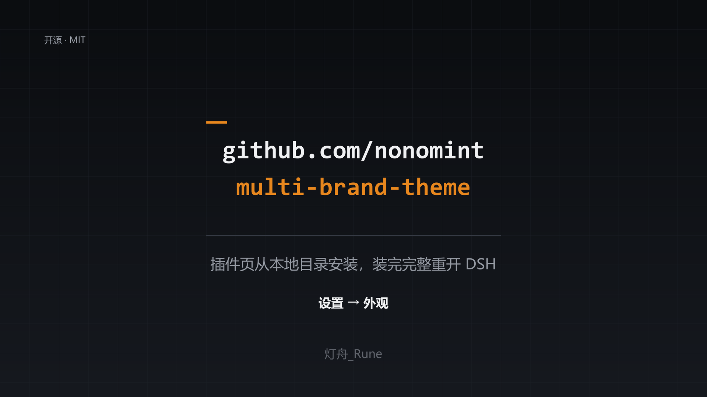

# multi-brand-theme

一个外观插件，管 DSH 的三处视觉：**强调色**、**侧栏品牌**、**新对话问候**。

设置里只多一个「外观」页，三段分区，互不影响；三段的存储键各自独立，升级/卸载不会串台。

- 包名：`@local/multi-brand-theme`
- 版本：1.0.0
- 形态：纯客户端插件（`index.js` 的 `apply()` 为空），不需要宿主资源
- 前身：`theme-palette` + `sidebar-logo` + `hero-greeting` 三个插件（2026-11-06 合并）

## 功能

### 1. 强调色

20 色色板（红、朱、橙、琥珀、橄榄、青柠、绿、翠、青绿、青、天蓝、蓝、靛、紫罗兰、紫、品红、粉、玫瑰、棕、石墨），外加「恢复默认」。

只覆盖装饰性令牌，背景、正文、边框一律不动：

```
--dsw-alias-brand-primary / brand-primary-hover
--dsw-alias-link / link-hover
--dsw-alias-button-primary-fill / button-primary-fill-hover
--dsw-alias-button-info-fill
选中高亮、聚焦环等派生装饰色
```

存储键 `dsh.theme-palette.v3`，形如 `{ "accent": "#2f6bff" }`；未选色＝跟随 DSH 默认品牌色。

### 2. 侧栏品牌

把侧栏左上角的品牌区换成 7 家第三方字标之一，或保留 DeepSeek 官方原样：

MiMo · Kimi · Qwen · Gemini · Codex · Claude · Grok · DeepSeek（官方）

落点是 `sidebar.brand.mark`（图标/字标）与 `sidebar.brand.name`（名称），注册 priority `-1`，压过官方默认占用；官方占用会被置为 inactive，切回「DeepSeek」时自动恢复。

存储键 `dsh.sidebar-logo.v1`。字标素材以 SVG path 或 base64 PNG（含亮/暗两版）内联在 `client.js` 的 `BRANDS` 常量里，运行时不发网络请求。

### 3. 新对话问候

把新对话页的「探索未至之境」换成按时段轮换的问候语：

- 标题按「早上/下午/晚上」等时段变化，副标题随机取一句；
- 设置页可选问候文字颜色跟随**主题色**还是**品牌色**；
- 通过 `:has()` 隐藏原生问候与预览版徽章，不改动其它页面。

落点 `conversation.hero.brand.mark`。存储键 `dsh.hero-greeting.v1`。

## 设置页

`settings.section`：id `appearance`，order `30`，标签「外观」。

```
外观
├─ 强调色       20 色 + 恢复默认
├─ 侧栏品牌     7 家 + DeepSeek 官方
└─ 新对话问候   实时预览 + 颜色来源开关 + 时段文案说明
```

所有文案走 `ctx.locale`，中英文各一份（`locale/zh.json`、`locale/en.json`）。

## 截图

四张卡片由本仓库 `docs/cards/` 的 PNG 提供，文案脚本在 `docs/promo-script.xlsx`。

| | |
|---|---|
|  |  |
|  |  |

## 安装

```powershell
git clone https://github.com/lanternboatrune/multi-brand-theme.git
& "D:\Deepseek\resources\runtime\cli\bin\dsh.cmd" plugin --profile desktop add `
  "<clone 目录>\multi-brand-theme"
```

也可以在 DSH 插件页「从本地目录安装」。注册后**完整退出并重开** DSH（客户端 bundle 在启动时捕获）。

依赖：`package.json` 的 `dsh.client.inject` 声明了

```
@deepseek-ai/dsh-client-ui-conversation
@deepseek-ai/dsh-client-ui-sidebar
@deepseek-ai/dsh-client-ui-settings
```

这三个包随 DSH Desktop 提供，无需单独安装。

## 技术说明

- **单文件三 IIFE**：`client.js` 里 `accentApi` / `brandApi` / `greetApi` 各占一个闭包，隔离各自的 `h`、样式表、状态与 `apply`，避免合并后键名/样式冲突。
- **样式注入**：每段用 `ctx.effect` 管理一个 `<style id="dsh-…">`，卸载时自动移除。
- **首屏不闪**：`dsh.client.immediately = true`，在 UI 首屏前完成注册。
- **数据内联**：品牌素材与问候文案都打包进 `client.js`（约 116 KB），不改运行时行为、不依赖 remote。

文件结构：

```
multi-brand-theme/
├── client.js          # 全部前端逻辑（三段 IIFE + AppearancePage）
├── index.js           # 宿主半边，空 apply
├── cordis.patch.yml    # insert: multi-brand-theme
├── package.json        # dsh.bundle.patch + dsh.client(inject)
├── icon.svg
├── locale/{zh,en}.json
└── README.md
```

开发提示：改品牌素材直接改 `BRANDS`、`MARK_PATH`、`MARK_PATHS` 三个常量（`MARK_PATHS` 是问候页的装饰路径）；不要再跑旧的一次性注入脚本。

## 排查

| 现象 | 原因 / 处理 |
|---|---|
| 设置里没有「外观」 | 插件没注册进 profile（`dependencies` + `bundles` 都要有）；或未重启 DSH |
| 强调色只变了一部分按钮 | 正常——只覆盖装饰性令牌；个别硬编码颜色的组件不跟随 |
| 侧栏品牌切回 DeepSeek 后没恢复 | 刷新页面；仍异常时清 `dsh.sidebar-logo.v1` 再选一次 |
| 问候语不出现 | 只作用于**新对话页**（hero 区）；已有会话不显示 |
| 升级后原有选择丢失 | 检查是否清过 localStorage；三段键名见上 |

## 第三方商标说明

侧栏品牌里的 MiMo、Kimi、Qwen、Gemini、Codex、Claude、Grok 等字标均为各自权利人的商标，此处内联仅作个人界面的品牌切换展示，与本项目不存在关联、赞助或背书关系，版权归各家所有。权利人若要求移除，删除 `client.js` 中对应的 `BRANDS` 条目即可。

## 许可证

[MIT](LICENSE) © 2026 wuyux
